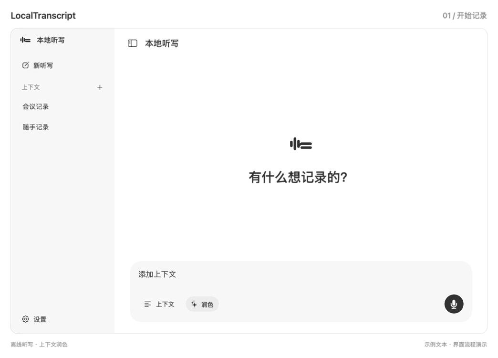

# LocalTranscript

[简体中文](README.md) | **English**

A native macOS app for offline microphone transcription and context-aware text polishing. It combines a conversational SwiftUI interface, continuous AVAudioEngine capture, whisper.cpp inference with Apple Silicon Metal/Accelerate, and local Ollama models for polishing and context naming.

## Demo



Select the “Meeting notes” context → see text appear → stop and finalize → view the polished result → switch to the original text.

The demo uses the app's actual SwiftUI views with preset sample text. Playback timing does not represent actual inference speed. The app interface shown in the demo is in Chinese.

## Quick start

Requirements: an Apple Silicon Mac, macOS 14+, Xcode or Command Line Tools, and CMake. Polishing also requires [Ollama](https://ollama.com/download/mac). 16GB of memory or more is recommended.

Run these commands from the repository directory:

```sh
xcode-select --install  # Skip if already installed
brew install cmake    # Skip if already installed
chmod +x Scripts/*.sh
./Scripts/bootstrap.sh
./Scripts/build.sh
open LocalTranscript.app
```

The initial build does not download models, so you can open the app first. Open **Settings (设置)** in the sidebar to choose and download models:

- **Speech model (语音模型):** choose Whisper Tiny / Base / Small, then click **Download and use (下载并使用)**. For an installed model, click **Switch (切换)**.
- **Polishing model:** choose Qwen 2.5 1.5B or Qwen3 4B Instruct, then click **Download and switch (下载并切换)**. Already downloaded models are reused.
- Relevant switching controls are disabled during recording, finalization, or polishing. If preparing a new model fails, the previous selection stays active.

Click the microphone at the bottom to start or stop recording (⌘R). You must grant microphone access yourself on first use. Enter context to describe background information and writing preferences, then save it for reuse. You can name a context manually; leave the name blank to have a local model generate a name of up to 10 characters. Saved contexts appear by name in the sidebar.

Once text is available, switch between **Polished (润色)** and **Original (原文)**. Copy, save as TXT, and export original subtitles as SRT using the result actions or the menu in the upper right. Starting a new transcription clears the current text, so save it first. Sessions are not automatically restored.

## Model setup

| Purpose | Model | Approximate download | License |
|---|---|---:|---|
| Speech | Whisper Tiny, multilingual | 75 MiB | MIT |
| Speech | Whisper Base, multilingual | 142 MiB | MIT |
| Speech | Whisper Small, multilingual | 466 MiB | MIT |
| Polishing/naming | qwen2.5:1.5b, Q4_K_M | 986 MB | Apache-2.0 |
| Polishing/naming | qwen3:4b-instruct, Q4_K_M | 2.5 GB | Apache-2.0 |

Small/4B is the quality-oriented option; Tiny/1.5B is lighter. Evaluate recognition accuracy and writing quality with your own use cases. All three speech models support Chinese and English; they are not specialized dialect models.

Speech weights come from [ggerganov/whisper.cpp](https://huggingface.co/ggerganov/whisper.cpp), pinned to revision `5359861c739e955e79d9a303bcbc70fb988958b1`. Downloads are checked against upstream SHA-1 digests before installation. The whisper.cpp code dependency is pinned to commit `5eaee0cc9024eb9e9a99469199920c8b7f5cb9ec`.

Polishing weights come from [Ollama Qwen 2.5](https://ollama.com/library/qwen2.5:1.5b) and [Qwen3 Instruct](https://ollama.com/library/qwen3:4b-instruct). Ollama pull verifies layer digests. After switching, new polishing and automatic naming requests use the selected model. Existing text is left as-is until you choose **Reprocess all text (重新润色全文)**.

Download locations:

- Speech: `~/Library/Application Support/LocalTranscript/Models/`. Compatible ggml weights in the app's Resources directory or a `Models/` directory next to the `.app` are also recognized.
- Polishing: `Models/Ollama` next to the `.app`, if that directory exists; otherwise `~/Library/Application Support/LocalTranscript/Ollama/`.
- Model weights are not included in this repository. Network access is needed for downloads; normal transcription and polishing do not send audio or text to the cloud.

To preinstall the default Small and 4B models from the command line:

```sh
./Scripts/download-model.sh
./Scripts/prepare-polish.sh
./Scripts/build.sh
```

Polishing connects only to `127.0.0.1:11435`, leaving Ollama's default port 11434 unchanged. The app stops only services it started itself. If polishing weights are missing or Ollama is not installed, you can still use transcription with a prepared speech model. Downloads use the system proxy configuration; retry after connectivity is restored if a download fails.

## Processing and limitations

The audio pipeline uses 16kHz mono PCM, a ring buffer, energy-based VAD, finalization after approximately 0.8 seconds of silence, and chunks of up to 10 seconds. Inference runs serially without blocking capture, with incremental drafts. Audio device changes or a processing backlog stop recording and display a message.

Recognition is chunk-based and near real time, rather than a word-by-word streaming model. Noise can affect energy-based VAD; quiet speech, short words, and chunk boundaries can cause omissions. Recognition errors still require human review.

Context is limited to 8,000 characters. Longer context increases the model window and memory use. It guides editing rather than enforcing substitutions. Negated or conditional clauses, numbers, and English fragments are preserved conservatively; rejected rewrites fall back to the original. As a result, passages with substantial English or meaning-sensitive content may remain largely unchanged. You can also edit generated context names manually.

Local builds are ad hoc signed and do not have Developer ID notarization. Opening the app on another Mac may require confirmation in System Settings. Rebuilding may require granting microphone access again.

## Checks

```sh
./LocalTranscript.app/Contents/MacOS/LocalTranscript --self-test
./LocalTranscript.app/Contents/MacOS/LocalTranscript --polish-test
./LocalTranscript.app/Contents/MacOS/LocalTranscript --model-catalog-test
```

The first two checks cover audio conversion, buffering and scheduling, the polishing queue, saved contexts, and automatic naming failures, cancellation, and retries. The model catalog check covers registered models and rejection of incorrect digests. `--model-download-test` downloads Tiny and 1.5B and verifies local inference; it requires network access and permission to write model caches. Run it with the local Ollama service available.

Microphone permission and a real speaking test must be completed by the user. macOS 14+ is the deployment target; not every supported OS release has been tested on hardware. See [VALIDATION.md](VALIDATION.md) for validation details.

## Privacy and open-source scope

This repository contains source code, build/setup scripts, the vector mark, demo assets using sample text, and licenses. It excludes personal contexts, user preferences, personal transcripts/recordings, session backups, test run logs, model weights, private keys, and machine-specific absolute paths. Runtime data stays on the user's Mac and is not committed to Git.

The application source is MIT licensed. whisper.cpp, Whisper, and Ollama use MIT licenses; Qwen weight licenses are listed above and at the official sources. License texts are included in `Licenses/`. The icon is generated during the build, with no image-service downloads required.
