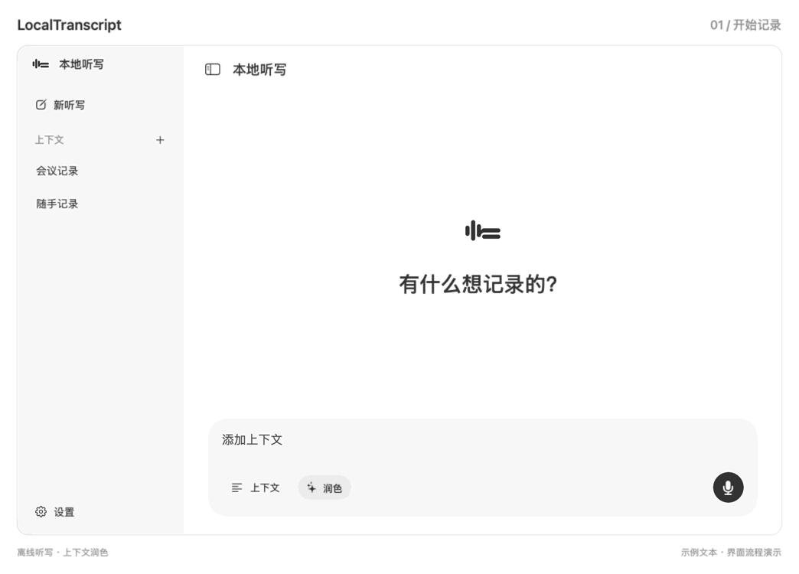

# LocalTranscript · 本地听写

原生 macOS 离线麦克风听写与上下文润色。SwiftUI 聊天式界面，AVAudioEngine 连续采集，whisper.cpp 使用 Apple Silicon Metal/Accelerate 推理；润色与上下文命名通过本机 Ollama 完成。

## 演示



选择“会议记录”上下文 → 文字逐步出现 → 停止定稿 → 查看润色结果 → 切换原文。

使用应用的真实 SwiftUI 界面和预置示例文本演示流程；播放节奏不代表实际推理速度。

## 快速开始

要求：Apple Silicon Mac、macOS 14+、Xcode 或 Command Line Tools、CMake。润色另需安装 [Ollama](https://ollama.com/download/mac)。建议 16GB 或更多内存。

```sh
xcode-select --install  # 已安装时跳过
brew install cmake    # 已安装时跳过
chmod +x Scripts/*.sh
./Scripts/bootstrap.sh
./Scripts/build.sh
open LocalTranscript.app
```

首次构建不下载模型，应用可以先打开。在左侧“设置”选择模型并下载：

- **语音模型**：选择 Whisper Tiny / Base / Small，点击“下载并使用”；已有模型可点“切换”。
- **润色模型**：选择 Qwen 2.5 1.5B 或 Qwen3 4B Instruct，点“下载并切换”；已下载时直接复用。
- 正在录音、定稿或润色时，相应切换操作不可用。新模型准备失败时保留原有选择。

点击底部麦克风开始/停止（⌘R）。首次使用亲自允许麦克风。输入上下文作为背景和表达偏好，可保存复用；名称可手动填写，留空时本地模型生成不超过10字的名称。左侧按名称选择上下文。

有文字后可以切换“润色 / 原文”；复制、TXT 保存和原文 SRT 导出在结果操作或右上角菜单中。开始新听写会清空当前文字，请先保存。没有自动会话恢复。

## 模型部署

| 用途 | 模型 | 大致下载量 | 许可 |
|---|---|---:|---|
| 语音 | Whisper Tiny，多语言 | 75 MiB | MIT |
| 语音 | Whisper Base，多语言 | 142 MiB | MIT |
| 语音 | Whisper Small，多语言 | 466 MiB | MIT |
| 润色/命名 | qwen2.5:1.5b，Q4_K_M | 986 MB | Apache-2.0 |
| 润色/命名 | qwen3:4b-instruct，Q4_K_M | 2.5 GB | Apache-2.0 |

Small/4B 适合优先考虑效果；Tiny/1.5B 更轻量，准确率和表达质量需按实际场景测试。当前三个语音选项均支持中文和英文，不是专门的方言模型。

语音权重来自 [ggerganov/whisper.cpp](https://huggingface.co/ggerganov/whisper.cpp)，固定 revision `5359861c739e955e79d9a303bcbc70fb988958b1`，下载后按上游公布的 SHA-1 校验，通过后安装。代码依赖固定 whisper.cpp commit `5eaee0cc9024eb9e9a99469199920c8b7f5cb9ec`。

润色权重来自 [Ollama Qwen 2.5](https://ollama.com/library/qwen2.5:1.5b) 和 [Qwen3 Instruct](https://ollama.com/library/qwen3:4b-instruct)，由 Ollama pull 校验层摘要。切换后新的润色及自动命名使用所选模型；已有文本不会被自动改写，可选择“重新润色全文”。

下载位置：

- 语音：`~/Library/Application Support/LocalTranscript/Models/`。也识别应用 Resources 及 `.app` 相邻 `Models/` 中兼容的 ggml 权重。
- 润色：如果存在 `.app` 相邻 `Models/Ollama` 则使用它，否则使用 `~/Library/Application Support/LocalTranscript/Ollama/`。
- 模型不包含在本仓库。只在下载时需要网络；正常识别和润色不向云端发送音频或文本。

命令行预部署默认 Small 和 4B：

```sh
./Scripts/download-model.sh
./Scripts/prepare-polish.sh
./Scripts/build.sh
```

润色服务仅访问 `127.0.0.1:11435`，不修改 Ollama 默认端口 11434。应用只停止自己启动的服务。模型缺失或 Ollama 未安装时，可以单独使用已准备好的听写功能。下载使用系统代理配置；网络不可达时在恢复网络后重试。

## 处理与限制

16kHz 单声道 PCM、循环缓冲、能量 VAD、约0.8秒静音定稿，最长10秒切段；串行非阻塞推理和增量草稿。音频设备变化或处理积压会停止并提示。

这是分块准实时识别，不是逐字流式模型。能量 VAD 可能受噪声影响，轻声、短词和分块边界可能漏字。ASR 错字仍需人工校对。

上下文最多8000字，较长内容增加模型窗口和内存占用。它是编辑参考，不是强制替换规则。否定/条件分句、数字及英文片段保守保留；不合格改写回退原文。因此英文或敏感含义较多的段落可能基本不变。模型生成的名称也可以手动修改。

本地构建采用临时签名，没有 Developer ID 公证；发布到其他 Mac 时可能需要在系统设置中确认打开。重新构建后可能需要再次授予麦克风权限。

## 检查

```sh
./LocalTranscript.app/Contents/MacOS/LocalTranscript --self-test
./LocalTranscript.app/Contents/MacOS/LocalTranscript --polish-test
./LocalTranscript.app/Contents/MacOS/LocalTranscript --model-catalog-test
```

前两类检查覆盖音频转换/缓冲/调度、润色队列、上下文保存及自动命名的失败/取消/重试。模型目录检查覆盖模型目录与错误摘要拒绝。`--model-download-test` 会联网下载 Tiny 和 1.5B 并验证本机推理，需要允许网络和模型缓存写入；请在 Ollama 本机服务可用时执行。

实际麦克风授权和说话测试必须由使用者完成。macOS 14+ 是编译目标，未对所有系统版本实机验证。

## 隐私与开源范围

本仓库只包含程序源码、构建/部署脚本、矢量标识和许可证。没有个人上下文、用户偏好、转录/录音、会话备份、测试运行日志、权重、私钥或本机绝对目录。运行时数据保存在使用者的本机，不提交到 Git。

源程序使用 MIT。whisper.cpp / Whisper / Ollama 为 MIT，Qwen 权重许可见上表及官方来源。随附文本在 `Licenses/`。图标在构建时生成，无需下载图像服务资源。
